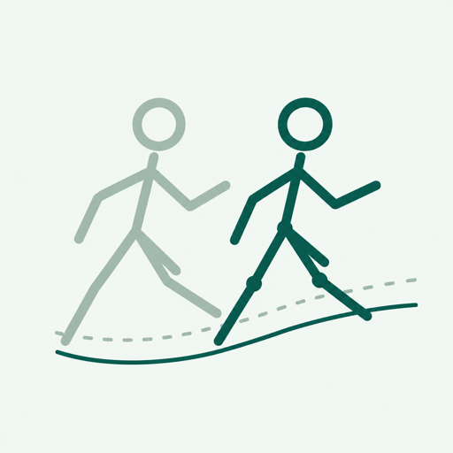

# MotionChallenge Core

An open, reproducible benchmark for humanoid motion tracking.

📏 Shared rules · 🔍 Public code · 🔁 Reproducible results

[🏆 Leaderboard](https://motionchallenge-project.github.io/motionchallenge/) ·
[🤖 Models](https://motionchallenge-project.github.io/motionchallenge/models/) ·
[📖 Protocol](https://motionchallenge-project.github.io/motionchallenge/protocol/)

<br clear="both">

## Install and run

```bash
git clone https://github.com/MotionChallenge-Project/MotionChallenge-Core.git
cd MotionChallenge-Core
uv sync
```

Run a checkpoint from a demo adapter with `uv run evaluate.py`.
Each adapter pins `MotionChallenge-Core` and produces verified results using the shared protocol.

## Demo Model adapters

| Model | Repository |
| :-- | :-- |
| GRIT | [Evaluation repository](https://github.com/MotionChallenge-Project/MotionChallenge-grit) |
| SONIC v1.1 | [Evaluation repository](https://github.com/MotionChallenge-Project/MotionChallenge-sonic-v1-1) |
| HoloMotion v1.4.1 | [Evaluation repository](https://github.com/MotionChallenge-Project/MotionChallenge-holomotion-v1-4-1) |
| PMT RGMT | [Evaluation repository](https://github.com/MotionChallenge-Project/MotionChallenge-pmt-rgmt) |

Clone an adapter with `--recurse-submodules`, then run `uv sync` and
`uv run evaluate.py`.

## Evaluation

Full-motion success, completion, joint error, and body-position error with
**XY+yaw / XY / no alignment**. Frozen physics and protocol; hashes and pose
traces support independent recomputation. Results, data, and weights stay outside
Git. Each result identifies its dataset, robot, checkpoint and protocol.

[Protocol](docs/PROTOCOL.md) · [Add a model](docs/ADAPTERS.md) ·
[Add a benchmark](docs/BENCHMARKS.md) ·
[Batch evaluation](docs/BATCHING.md) ·
[Code layout](docs/ARCHITECTURE.md) ·
[Website](https://motionchallenge-project.github.io/motionchallenge/) ·
[Project](https://github.com/MotionChallenge-Project)

Apache-2.0. [Third-party notices](THIRD_PARTY_NOTICES.md).

All controllers use [ideal proprioception without global position feedback](docs/OBSERVATIONS.md).

## Citation

If you use MotionChallenge in your research, please cite:

```bibtex
@misc{motionchallenge2026,
  author       = {{MotionChallenge Team}},
  title        = {{MotionChallenge}: An Open, Reproducible Benchmark for Humanoid Motion Tracking},
  year         = {2026},
  url          = {https://motionchallenge-project.github.io/motionchallenge/}
}
```

[Download BibTeX](CITATION.bib).
